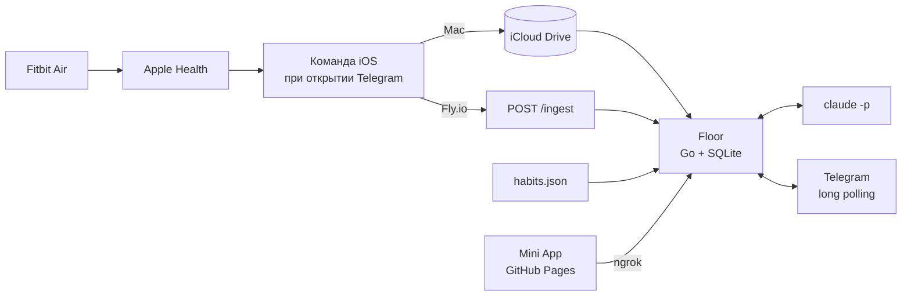

<div align="center">

# Floor

**Минимальный уровень жизни, который держится даже в плохой день.**

Личный Telegram-бот: Fitbit → Apple Health → Go → Telegram, с Claude для одного шага в день.<br>
Один тап в день. Без дашбордов, стриков и стыда.

[](https://github.com/adamauthor/floor/actions/workflows/ci.yml)


</div>

---

## Как это выглядит

<table>
<tr><td width="50%" valign="top">

**📌 Всегда наверху чата**

```text
📌 Привычки и якоря

⏰ Подъём · неделя 2 из ~10
когда звонит будильник в 07:00
→ сразу встаю, ноги на пол
пол: сел на кровати

🚶 Улица · неделя 2 из ~10
когда закрыл ноутбук после работы
→ куртка и 20 минут на улице
пол: выйти за дверь

Пол — минимум на плохой день.
Пропуск не обнуляет.
Не пропускай дважды.
```

</td><td width="50%" valign="top">

**☀️ Каждое утро**

```text
☀️ Суббота, 31 октября

Подъём 07:24 — в пределах часа от якоря ✅
Сон 7 ч 21 мин
Шаги вчера 7 812 — пол взят ✅ (цель 10 000)

Шаг на сегодня: когда закрою ноутбук
→ куртка и 20 минут на улице
```

**🌙 Каждый вечер, один-два тапа**

```text
🌙 Как прошёл день?
Жми на привычку: · → пол → цель.

[ ⏰ Подъём · пол     ]
[ 🚶 Улица · цель ✅  ]
[ Всё на полу ] [ Готово ]
```

</td></tr>
</table>

**📅 Каждое воскресенье**

```text
📅 Неделя 26 окт — 1 ноя

        Пн  Вт  Ср  Чт  Пт  Сб  Вс
Подъём  ✅  ✅  ·   ✅  ✅  ·   ✅
Шаги    8к  6к  2к  7к  9к  3к  …
Пол     ✅  ✅  ❌  ✅  ✅  ❌  …

Подъём в норме: 5 из 7, разброс 1 ч 10 мин
Шаги: пол взят 3 из 6

Якоря на неделю:
когда звонит будильник в 07:00 → сразу встаю, ноги на пол
когда закрыл ноутбук после работы → куртка и 20 минут на улице

Получилось: …
Просело: …
На следующую неделю: …
```

**💬 В любой момент** можно просто написать. Claude ответит с контекстом последних двух недель, твоих привычек и якорей.

## Что считается

| Метрика | Источник | Пол | Цель |
|---|---|---|---|
| Подъём в одно время | Fitbit → Apple Health | ±60 мин от якоря | ±30 мин |
| Шаги | Fitbit → Apple Health | 7 000 | 10 000 |
| Пол дня | одна кнопка | да | — |

**Пол дня** — зубы, выйти на улицу, одна вещь на место. Сделал — день засчитан, всё сверху бонус. Цифры считает код, а не модель: Claude пишет только шаг дня и три строки итога недели. Без Claude всё продолжает работать на запасных текстах.

## Привычки и настройки

Каждая привычка — связка «когда X → делаю Y», и список всегда перед глазами в закреплённом сообщении. «Неделя N» — возраст привычки, а не стрик: пропуски его не сбрасывают.

Всё меняется в самом Telegram: кнопка меню **Floor** слева от поля ввода открывает Mini App с привычками, якорями, временем подъёма, шагами и временем сообщений. Текущие настройки бот передаёт в адресе кнопки (после `#`, на хостинг они не уходят). Изменения страница шлёт боту через туннель ngrok (`make install-tunnel`): бот слушает только `127.0.0.1:8791`, принимает запрос лишь с подписью Telegram от владельца и сам узнаёт текущий адрес туннеля. Сохранённое в Telegram перекрывает значения из `.env`.

Как выбрать якорь и что значит каждое поле — [`docs/HABITS.md`](docs/HABITS.md).

## Версия 2.0

- **💰 Деньги.** Пишешь остатки свободным текстом («рбк 142к, подушка 900к, долг 1,1 млн») → бот разбирает, просит подтвердить и показывает, идёшь ли по плану: долги, подушка, деньги на жизнь до зарплаты. План — `~/.floor/money.json`, расчёты — код (`internal/money`), Claude пишет только последнюю строку. Номера карт не сохраняются нигде. Проверка и расчёт: `floor money`.
- **🏋️ Тренировки.** Привычка `kind: workout` с недельной целью засчитывается сама по сессиям из Google Health; без часов — кнопка «Была без часов».
- **🪜 Очередь привычек.** `queued: true` — привычка ждёт: в воскресенье бот предложит её, когда пол держится 10 из 14 дней и есть место.
- **📚 Финграмотность.** 13 недель, тема в понедельник утром и «сделано / перенести» в воскресенье.
- **Воскресенье 2.0.** Узкое место недели вместо «Просело», строка денег, вопрос про людей.

## Как устроено



- **Бесплатно:** данные выгружает встроенное приложение «Команды», Claude работает через подписку (`claude -p`), бот живёт на Маке.
- **Часовой пояс** берётся из данных телефона: сменил страну — утро и вечер сами переехали на местное время.
- **Приватно:** данные остаются на твоей машине, наружу уходит только контекст промпта к Claude; через туннель виден один адрес для сохранения настроек, и он принимает только подписанные Telegram запросы владельца. Токены и тексты сообщений в логи не попадают.
- **24/7 при желании:** тот же код на Fly.io (~$2–4 в месяц), меняется одна переменная.

## Почему именно так

| Решение | Основание |
|---|---|
| Шаг дня только в форме «когда X → делаю Y» | Планы «если — то», d≈0,65 (Gollwitzer & Sheeran, 2006) |
| Без мотивации и вдохновения | Сильный сдвиг намерения даёт намного меньший сдвиг поведения (Webb & Sheeran, 2006) |
| Без стриков, правило «не пропускай дважды» | Сломанный стрик снижает повторение (Silverman & Barasch, 2023) |
| Якоря вместо напоминаний | Напоминания поддерживают повторение, но мешают автоматизму (Stawarz et al., 2015) |
| Подъём как главная метрика сна | Регулярность сильнее связана со смертностью, чем длительность (Windred et al., 2024) |
| Пол 7 000 шагов, цель 10 000 | Основная польза набирается к 5000–7000 (Ding et al., 2025) |

Какие цифры подтвердились, а какие нет: [`docs/RESEARCH.md`](docs/RESEARCH.md). Что делать дальше: [`docs/RECOMMENDATIONS.md`](docs/RECOMMENDATIONS.md).

## Быстрый старт

Нужны Go 1.26+ и авторизованный `claude` CLI. Без него бот работает на запасных текстах.

1. Создай бота у [@BotFather](https://t.me/BotFather) и узнай свой id у [@userinfobot](https://t.me/userinfobot). Подключи данные одним из способов:
   - **Google Health** (по умолчанию): Fitbit отдаёт шаги и сон напрямую, без iPhone, см. [инструкцию](docs/GOOGLE_HEALTH.md), вход через `make google-auth`;
   - **Команда на iPhone** (`HEALTH_SOURCE=file`): выгрузка из Apple «Здоровья» в iCloud Drive, см. [инструкцию](docs/IPHONE_SHORTCUT.md).

2. Заполни `TELEGRAM_TOKEN` и `TELEGRAM_OWNER_ID`:

   ```bash
   cp .env.example .env
   ```

3. Запусти и напиши боту `/start`: Telegram не даёт ботам писать первыми.

   ```bash
   make run
   ```

4. Поставь фоновым сервисом на Маке, а якоря и время поправь кнопкой «Floor» слева от поля ввода:

   ```bash
   make install-launchd
   ```

   Сервис работает с копией настроек в `~/.floor/.env`. После правки `.env` или обновления кода снова запусти `make install-launchd`: он пересоберёт бинарь и перезапустит бота. Привычки и время из «⚙️ Настройки» применяются сразу, без перезапуска.

При первом чтении iCloud Drive фоновым сервисом macOS может запросить доступ к файлам. Деплой на Fly.io описан в [ТЗ, раздел 11.2](docs/SPEC.md#112-flyio-247-24-в-месяц).

## Команды

| Команда | Что делает |
|---|---|
| `/settings` в чате | Обновить кнопку «Floor» |
| `make run` | Запустить с `.env` |
| `make habits` | Показать привычки и якоря, проверить `habits.json` |
| `floor money [--date D] [текст]` | Проверить `money.json`, отчёт по последней сверке или по тексту сверки без сохранения |
| `make google-auth` | Войти в Google Health (`HEALTH_SOURCE=google`) |
| `make debug-day DAY=2026-10-31` | Метрики дня из базы |
| `make test` / `make cover` / `make lint` | Тесты с гонками, покрытие, `go vet` и staticcheck |
| `make logs` | Логи фонового сервиса |

## Документация

| Документ | О чём |
|---|---|
| [`docs/SPEC.md`](docs/SPEC.md) | Техническое задание: сценарии, метрики, архитектура, критерии приёмки |
| [`docs/HABITS.md`](docs/HABITS.md) | Привычки и якоря: как устроено, как менять, как выбрать якорь |
| [`docs/GOOGLE_HEALTH.md`](docs/GOOGLE_HEALTH.md) | Как подключить Fitbit через Google Health API |
| [`docs/IPHONE_SHORTCUT.md`](docs/IPHONE_SHORTCUT.md) | Как собрать Команду на iPhone |
| [`docs/ACCEPTANCE.md`](docs/ACCEPTANCE.md) | Что проверено автотестами, а что ждёт реального телефона |
| [`docs/RESEARCH.md`](docs/RESEARCH.md) | Проверка исходных исследований и обзор новых |
| [`docs/RECOMMENDATIONS.md`](docs/RECOMMENDATIONS.md) | Кандидаты в новые функции с обоснованием |
| [`docs/BACKLOG.md`](docs/BACKLOG.md) | Идеи на потом |

## Дорожная карта

- [ ] **M0** — Команда на iPhone, `health.json` в iCloud
- [x] **M1** — конфиг, хранилище, парсер, метрики и тесты
- [x] **M2** — Telegram: утро, вечер, неделя без Claude, карточка привычек
- [x] **M3** — Claude: шаг дня, сводка, свободный текст
- [x] **M4** — launchd, Mini App, отметка по привычкам
- [x] **M5–M9** — 2.0: деньги, тренировки, очередь привычек, финграмотность, воскресенье 2.0
- [ ] **M10** — 14 дней пользования 2.0 и ретро

## Правило проекта

> Объём заморожен. Новые идеи — в [`BACKLOG.md`](docs/BACKLOG.md), а не в код.
> Сначала 14 дней живём с тем, что есть.

## Лицензия

[MIT](LICENSE)
