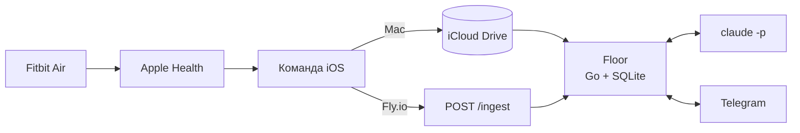

<div align="center">

# Floor

**Минимальный уровень жизни, который держится даже в плохой день.**

Персональный Telegram-бот: Fitbit → Apple Health → Claude → Telegram.
Один тап в день. Никаких дашбордов, стриков и стыда.

[](https://github.com/OWNER/floor/actions/workflows/ci.yml)


</div>

---

## Что делает

| Когда | Что приходит | Что делаешь ты |
|---|---|---|
| ☀️ Утро | Подъём относительно якоря, сон, шаги за вчера и **один** шаг на сегодня | Читаешь, 5 секунд |
| 🌙 Вечер | «Пол на сегодня» с тремя кнопками | **Один тап**: ✅ / ❌ / ✈️ |
| 📅 Воскресенье | Таблица недели и три строки: что получилось, что просело, что дальше | Читаешь, 30 секунд |
| 💬 В любой момент | Пишешь что угодно, Claude отвечает с контекстом последних двух недель | По желанию |

**Пол дня** — зубы, выйти на улицу, одна вещь на место. Если сделал, день засчитан. Всё сверху — бонус.

## Три метрики, все автоматически

| Метрика | Источник | Пол | Цель |
|---|---|---|---|
| Подъём в одно время | Fitbit → Apple Health | ±60 мин от якоря | ±30 мин |
| Шаги | Fitbit → Apple Health | 4 000 | 7 000 |
| Пол дня | одна кнопка | да | — |

## Как это устроено



- **Бесплатно:** данные выгружает встроенное приложение «Команды», Claude работает через твою подписку (`claude -p`), бот живёт на Маке.
- **Путешествия:** часовой пояс берётся из данных телефона. Сменил страну — утро и вечер сами переезжают на местное время.
- **24/7 при желании:** тот же код на Fly.io (~$2–4 в месяц), меняется одна переменная.

## Почему именно так

Каждое решение опирается на исследование: регулярность сна важнее длительности (Windred 2024), основная польза шагов до 7 000 (Ding 2025), пропуск не обнуляет привычку (Lally 2010), самокритика тормозит изменения (Breines & Chen 2012), действие идёт раньше мотивации (поведенческая активация). Таблица принципов — в [ТЗ, раздел 0](docs/SPEC.md#0-зачем-это-всё).

## Быстрый старт

```bash
# 1. Команда на iPhone — один раз
open docs/IPHONE_SHORTCUT.md

# 2. Конфиг
cp .env.example .env        # TELEGRAM_TOKEN, TELEGRAM_OWNER_ID

# 3. Запуск
make run                    # локально
make install-launchd        # как фоновый сервис на Маке
```

Деплой на Fly.io — [ТЗ, раздел 11.2](docs/SPEC.md#112-flyio-247-24-в-месяц).

## Документация

| Документ | О чём |
|---|---|
| [`docs/SPEC.md`](docs/SPEC.md) | Полное техническое задание: сценарии, метрики, архитектура, критерии приёмки |
| [`docs/IPHONE_SHORTCUT.md`](docs/IPHONE_SHORTCUT.md) | Как собрать Команду на iPhone для выгрузки данных |
| [`docs/BACKLOG.md`](docs/BACKLOG.md) | Идеи на потом. Не реализуются до ретро |

## Дорожная карта

- [ ] **M0** — Команда на iPhone, `health.json` в iCloud
- [ ] **M1** — конфиг, хранилище, парсер, метрики и тесты
- [ ] **M2** — Telegram: утро, вечер, неделя без Claude
- [ ] **M3** — Claude: шаг дня, сводка, свободный текст
- [ ] **M4** — launchd, 14 дней пользования, ретро

## Правило проекта

> Объём заморожен. Новые идеи — в [`BACKLOG.md`](docs/BACKLOG.md), а не в код.
> Сначала 14 дней живём с тем, что есть.

## Лицензия

[MIT](LICENSE)
