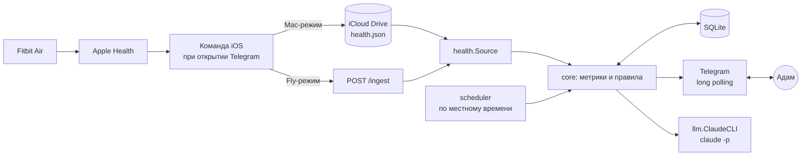

# Floor — техническое задание

> Версия 1.1 · 31 октября 2026 · статус: реализовано, идёт проверка на реальных данных
> Объём заморожен. Всё, чего нет в этом документе, — вне скоупа v1 (см. раздел 12).

---

## 0. Зачем это всё

Floor — персональный Telegram-бот, который помогает держать **«пол»**: минимальный уровень жизни, который выполняется даже в самый плохой день. Бот не мотивирует, не геймифицирует и не ругает. Он автоматически собирает данные, раз в день коротко отражает реальность и предлагает **один** следующий шаг.

### Принципы (из исследований, на которых построена система)

| Принцип | Откуда | Что это значит для продукта |
|---|---|---|
| Намерение слабо двигает поведение | Sheeran 2002; Webb & Sheeran 2006 | Бот не «вдохновляет». Только факты и один конкретный шаг |
| Триггер «если X, то Y» работает | Gollwitzer & Sheeran 2006 | Шаг дня всегда сформулирован как «когда X → делаю Y» |
| Пропуск не обнуляет привычку | Lally et al. 2010 | Правило «не пропускай дважды», никаких стриков с обнулением |
| Самокритика тормозит | Breines & Chen 2012 | Тон всегда без стыда, без оценок «плохо/хорошо» |
| Действие раньше мотивации | Behavioral Activation | Шаг дня — маленький и выполнимый без желания |
| Новизна угасает | Schultz et al. 1997 | Интерфейс скучный и постоянный, ручной ввод ≈ 0 |
| Регулярность сна > длительность | Windred et al. 2024 | Главная метрика сна — время подъёма относительно якоря |
| Основная польза шагов до 7000 | Ding et al. 2025 | Пол 7000, цель 10000 |

### Целевой опыт пользователя

- В день: **1 тап** (вечерняя кнопка). Всё остальное — автоматически.
- В неделю: **1 сообщение** со сводкой, которое читается за 30 секунд.
- Никаких команд, дашбордов, настроек в интерфейсе.

---

## 1. Термины

| Термин | Определение |
|---|---|
| **Якорь подъёма** | Целевое время подъёма в местном часовом поясе. По умолчанию `07:00` |
| **Привычка** | Одно действие, запускаемое одним контекстом. Список — в `habits.json` (см. 2.5) |
| **Якорь привычки** | Контекст, который запускает действие: «когда X». Не время, а событие дня |
| **Местный день** | Календарный день в часовом поясе, последнем известном из данных iPhone |
| **Подъём** | Конец последнего сегмента сна, начавшегося в «ночном окне» (см. 3.2) |
| **Пол дня** | Три действия: зубы, выйти на улицу, одна вещь на место. Отмечается одной кнопкой |
| **Пропуск** | День, в котором пол отмечен как «нет» или не отмечен вовсе |

---

## 2. Пользовательские сценарии

### 2.1. Утро — сводка

**Когда:** один раз за местный день, при первом из событий:
1. пришли данные о здоровье, в которых виден подъём сегодня **и** с момента подъёма прошло ≥ 30 минут;
2. наступило `якорь + 3 часа` (fallback, даже если данных нет).

**Что:**

```
☀️ Суббота, 31 октября

Подъём 07:24 — в пределах часа от якоря ✅
Сон 6 ч 40 мин
Шаги вчера 4 812 — пол взят ✅ (цель 7 000)

Шаг на сегодня: когда закроешь ноутбук после работы — сразу куртка и 20 минут на улицу.
```

- Первые три строки формируются **кодом**, а не Claude (детерминированно, без галлюцинаций).
- Последняя строка — от Claude (см. 7.3). Если Claude недоступен — берётся строка из статического пула (см. 7.5).
- Если данных нет: вместо цифр — `Данных пока нет — открой Telegram на телефоне, они подтянутся сами.` и шаг дня.

### 2.2. Вечер — отметка пола

**Когда:** ежедневно в `EVENING_AT` местного времени (по умолчанию `21:00`).

```
🌙 Пол на сегодня: зубы · выйти на улицу · одна вещь на место

[ ✅ Да ]  [ ❌ Нет ]
```

- Нажатие сохраняет статус, кнопки заменяются на короткий ответ (редактирование того же сообщения, не новое):
  - ✅ → `Засчитано.`
  - ❌ → `Ок. Завтра просто пол.` (без утешений и без морали)
- Если вчера тоже ❌ или не отмечено → после ❌ дописывается: `Два дня подряд — завтра делаем только пол, ничего сверху.`
- Кнопку можно нажать до 12:00 следующего местного дня (ночные отметки). Позже — сообщение протухает, день остаётся «не отмечен».
- Повторное нажатие перезаписывает статус.

### 2.3. Воскресенье — недельная сводка

**Когда:** воскресенье, `WEEKLY_AT` местного времени (по умолчанию `20:00`), отдельным сообщением. Вечерняя кнопка в воскресенье приходит как обычно.

**Что:** таблица недели (код) + 3 строки от Claude:

```
📅 Неделя 26 окт — 1 ноя

        Пн  Вт  Ср  Чт  Пт  Сб  Вс
Подъём  ✅  ✅  ·   ✅  ✅  ·   ✅
Шаги    4к  6к  2к  5к  7к  3к  …
Пол     ✅  ✅  ❌  ✅  ✅  ❌  …

Получилось: …
Просело: …
На следующую неделю: …
```

Легенда: подъём ✅ = в пределах ±60 мин от якоря, `·` = нет данных/мимо; шаги округлены до тысяч.

### 2.4. Свободный текст

Любое текстовое сообщение от владельца → ответ Claude с контекстом последних 14 дней (см. 7.4). Без команд (исключения — служебный `/start`, без которого Telegram не даёт боту писать первым, и `/settings`, который присылает кнопку настроек). Настройки — Telegram Mini App `docs/app/` на GitHub Pages: состояние приходит во фрагменте адреса кнопки, изменения возвращаются через `sendData` и применяются сразу. Голосовые сообщения — вне скоупа v1 (бот отвечает: `Пока только текст.`).

### 2.5. Привычки и якоря

Цель: всегда видеть, какие привычки сейчас развиваются и что их запускает, без команд и экранов настроек.

**Источник правды** — файл `HABITS_FILE` (`~/.floor/habits.json`), создаётся при первом запуске, правится руками, подробности в [`HABITS.md`](HABITS.md):

```json
{
  "habits": [
    {
      "id": "outside",
      "emoji": "🚶",
      "title": "Улица",
      "anchor": "закрыл ноутбук после работы",
      "action": "куртка и 20 минут на улице",
      "floor_label": "выйти на улицу",
      "since": "2026-10-31"
    }
  ]
}
```

- `{wake}` в якоре заменяется на `WAKE_ANCHOR`. Непустой `floor_label` включает привычку в пол дня. `paused: true` убирает её отовсюду, не теряя `since`.
- Не больше 5 активных привычек (`habits.MaxActive`). Опечатка в имени поля, привычка без якоря или повтор `id` делают файл невалидным.

**Где привычки видны:**

| Место | Что показывает |
|---|---|
| Закреплённое сообщение | Карточка: все привычки, якоря, неделя с начала, состав пола. Всегда наверху чата |
| Вечер | Состав пола берётся из `floor_label` |
| Воскресенье | Блок «Якоря на неделю» в сводке |
| Claude | Шаг дня и ответы опираются на существующие якоря, новых не придумывают |

```
📌 Привычки и якоря

⏰ Подъём · неделя 2 из ~10
когда звонит будильник в 07:00 → сразу встаю, ноги на пол

🚶 Улица · неделя 2 из ~10
когда закрыл ноутбук после работы → куртка и 20 минут на улице

Пол дня: зубы · выйти на улицу · одна вещь на место
Пропуск не обнуляет. Не пропускай дважды.
```

**Правила карточки:**

- Отправляется и закрепляется один раз, без уведомления. Дальше то же сообщение редактируется: при смене недели и при правке файла. Сравнение по хешу текста, лишних запросов нет.
- Если сообщение удалено — отправляется и закрепляется заново.
- «Неделя N» — возраст привычки, а не стрик: пропуски её не сбрасывают. «~10» — ориентир из Lally et al. 2010 (медиана 66 дней), после десятой недели подпись становится просто «неделя N».
- Невалидный файл не ломает бота: остаётся прошлая версия, и один раз на версию файла приходит сообщение с ошибками. Проверить заранее: `floor habits`.

---

## 3. Метрики и правила расчёта

### 3.1. Шаги

- Источник: сумма шагов за местный календарный день из выгрузки.
- Пол: `steps >= 7000` (`STEPS_FLOOR`). Цель: `steps >= 10000` (`STEPS_GOAL`).
- Если за день пришло несколько выгрузок — берётся **максимальное** значение (суммы растут в течение дня).

### 3.2. Сон и подъём

- Эпизод относится к дню D, если начался с `D-1 18:00` до `D 18:00` местного времени (в смещении самого эпизода). У каждого эпизода ровно один день: поздний подъём не засчитывается двум дням.
- Учитываются сегменты сна (`asleep`, `core`, `deep`, `rem`, `unspecified`); сегменты `inBed`/`awake` игнорируются.
- Сегменты, между которыми разрыв < 60 мин, склеиваются в один «эпизод».
- **Основной эпизод** ночи = самый длинный эпизод, относящийся к дню.
- **Подъём** = конец основного эпизода. **Длительность сна** = сумма сегментов основного эпизода.
- Дневной сон (эпизоды < 3 ч, начавшиеся с 10:00 до 18:00) не влияет на подъём. Верхняя граница отделяет его от короткой ночи вроде 23:00–01:30.
- Сегменты могут накладываться (два источника в Apple Health): длительность считается по объединению, а не суммой.
- Каждая выгрузка видит только «последние 2 дня», поэтому ночь пересчитывается по объединению выгрузок за 5 дней: новая неполная выгрузка не укорачивает уже известную ночь.

### 3.3. Регулярность

- `wake_delta = подъём − якорь` (в минутах, со знаком).
- Подъём «в норме»: `|wake_delta| <= 60` (`WAKE_TOLERANCE_MIN`). Цель: `<= 30`.
- В недельной сводке — сколько дней из 7 в норме и разброс (max − min) времени подъёма.

### 3.4. Пол и «не пропускай дважды»

- Статус дня: `yes | no | none`.
- «Два подряд» = сегодня `no`, а вчера `no` или вопрос был задан и не отмечен. День, в который бот не спрашивал (Мак спал, бота ещё не было), пропуском не считается: вопроса не было.
- **Никаких стриков в интерфейсе.** Счётчик «N дней подряд» не показывается намеренно.

---

## 4. Данные с iPhone (контракт)

Выгрузку формирует Команда iOS (см. `IPHONE_SHORTCUT.md`). Формат — JSON, `Content-Type: application/json`.

```json
{
  "schema": 1,
  "generated_at": "2026-10-31T08:12:44+05:00",
  "tz_offset": "+05:00",
  "steps": [
    { "date": "2026-10-30", "count": 4812 },
    { "date": "2026-10-31", "count": 1203 }
  ],
  "sleep": [
    { "start": "2026-10-30T23:51:00+05:00", "end": "2026-10-31T03:10:00+05:00", "value": "asleep" },
    { "start": "2026-10-31T03:22:00+05:00", "end": "2026-10-31T07:24:00+05:00", "value": "core" }
  ]
}
```

Требования к парсеру:
- Неизвестные поля игнорируются. `schema != 1` → ошибка в лог, данные не применяются.
- Все времена — RFC 3339 со смещением. Даты шагов — локальные даты iPhone на момент выгрузки.
- Значения `value` нормализуются к нижнему регистру; русские названия стадий из iOS (`Сон`, `Основной`, `Глубокий`, `REM`, `В кровати`, `Бодрствование`) маппятся на английские.
- Выгрузка **идемпотентна**: одна и та же выгрузка, применённая дважды, не меняет результат.
- Пустые массивы допустимы (нет данных ≠ ошибка).

### 4.1. Источники (интерфейс `health.Source`)

```go
type Source interface {
    // Updates возвращает канал выгрузок. Закрывается при остановке ctx.
    Updates(ctx context.Context) (<-chan Export, error)
}
```

| Реализация | Режим | Как получает данные |
|---|---|---|
| `health.FileSource` | Mac | Следит за файлом `HEALTH_FILE` (по умолчанию `~/Library/Mobile Documents/com~apple~CloudDocs/Floor/health.json`). Опрос mtime раз в 30 с (iCloud-файлы плохо дружат с fsnotify) |
| `health.HTTPSource` | Fly | `POST /ingest`, заголовок `Authorization: Bearer $INGEST_TOKEN`. Ответ `204`. Тело ≤ 1 МБ. Неверный токен → `401` без деталей |

Выбор реализации — переменная `HEALTH_SOURCE=file|http`.

---

## 5. Архитектура



### 5.1. Пакеты

```
cmd/floor/            точка входа, сборка зависимостей, graceful shutdown, debug-day, habits
internal/config/      env → Config, валидация
internal/core/        выгрузки, сценарии, кнопки и текст: связывает всё ниже
internal/habits/      привычки и якоря: habits.json, проверка, неделя с начала
internal/health/      Export, парсер, FileSource, HTTPSource
internal/metrics/     сон → эпизоды → подъём; шаги; пол; правила 3.x (чистые функции)
internal/store/       SQLite: дни, выгрузки, сообщения, состояние
internal/schedule/    тикер раз в минуту, расчёт «пора ли» по местному времени
internal/llm/         интерфейс Client + ClaudeCLI + статический fallback
internal/bot/         Telegram: отправка, кнопки, callback, свободный текст
internal/render/      тексты сообщений (утро, вечер, неделя, карточка) — чистые функции
internal/tgtest/      поддельный Bot API для тестов
```

Правило: `metrics` и `render` — без I/O, покрыты табличными тестами. Всё с I/O — за интерфейсами.

### 5.2. Один процесс

Одна горутина на источник данных, одна на Telegram long polling, один тикер расписания. Общее состояние — только через `store` (SQLite, `journal_mode=WAL`, `busy_timeout=5000`). Никаких внешних брокеров и очередей.

---

## 6. Хранилище (SQLite)

```sql
CREATE TABLE days (
    date            TEXT PRIMARY KEY,      -- местная дата YYYY-MM-DD
    tz_offset       TEXT NOT NULL,         -- смещение на момент последнего обновления
    steps           INTEGER,               -- NULL = нет данных
    sleep_minutes   INTEGER,
    wake_at         TEXT,                  -- RFC 3339
    wake_delta_min  INTEGER,
    floor_status    TEXT NOT NULL DEFAULT 'none'
                    CHECK (floor_status IN ('yes','no','none')),
    morning_sent_at TEXT,
    evening_sent_at TEXT,
    evening_msg_id  INTEGER,
    updated_at      TEXT NOT NULL
);

CREATE TABLE exports (                     -- сырые выгрузки, для отладки и пересчёта
    id           INTEGER PRIMARY KEY,
    received_at  TEXT NOT NULL,
    sha256       TEXT NOT NULL UNIQUE,     -- идемпотентность
    payload      TEXT NOT NULL
);

CREATE TABLE messages (                    -- контекст свободного диалога
    id          INTEGER PRIMARY KEY,
    at          TEXT NOT NULL,
    role        TEXT NOT NULL CHECK (role IN ('user','assistant')),
    text        TEXT NOT NULL
);

CREATE TABLE kv (                          -- состояние: последний tz, weekly_sent_for и т.п.
    key   TEXT PRIMARY KEY,
    value TEXT NOT NULL
);
```

- Миграции — встроенные (`embed`), версия в `PRAGMA user_version`.
- `exports` хранятся 30 дней, потом удаляются раз в сутки.
- `messages` хранятся 60 дней.
- Файл БД: `DB_PATH` (Mac: `~/.floor/floor.db`, Fly: `/data/floor.db`). **Никогда не коммитится.**

---

## 7. Claude

### 7.1. Интерфейс

```go
type Client interface {
    Ask(ctx context.Context, system, prompt string) (string, error)
}
```

### 7.2. Реализация `ClaudeCLI`

- Запуск: `claude -p --output-format json --no-session-persistence --tools "" --setting-sources "" --strict-mcp-config --append-system-prompt "<system>"`, промпт — в stdin. Без инструментов, без настроек и `CLAUDE.md` пользователя, без сохранения сессии на диск: в промпте данные о здоровье.
- Рабочая директория — пустая временная папка (Claude не должен видеть файлы проекта).
- Таймаут — `LLM_TIMEOUT` (по умолчанию 90 с). Один ретрай с паузой 5 с.
- Ответ: из JSON берётся поле `result`. Ошибка/пустой ответ → fallback (7.5).
- Авторизация: Mac — текущий логин Claude Code; Fly — `CLAUDE_CODE_OAUTH_TOKEN` (получается через `claude setup-token`).
- Флаги сверены с Claude Code 2.1.306, вызов проверен вживую: `FLOOR_LIVE_CLAUDE=1 go test -run TestLiveClaude -v ./internal/llm`.
- Лимит: не более `LLM_MAX_CALLS_PER_DAY` (по умолчанию 30) вызовов в сутки, сверх лимита — fallback.

### 7.3. Системный промпт (общий)

```
Ты — Floor, личный помощник Адама. Пишешь по-русски, коротко, на «ты».
Правила:
- Только обычный текст, без markdown.
- Никакого стыда, морали, оценок «плохо/хорошо», мотивационных лозунгов.
- Никогда не выдумывай цифры. Используй только данные из контекста.
- Если данных нет — так и скажи одной фразой.
- В таблице есть только подъём, сон, шаги и пол. Не утверждай, что отдельная привычка
  выполнена или пропущена, если этого в таблице нет.
- Шаг всегда один, маленький, выполнимый без желания, в форме «когда X → делаю Y».
- Опирайся на привычки и якоря из контекста: X бери из существующего якоря, а не придумывай новый.
- Не предлагай новых привычек, целей, приложений и систем.
- Никаких стриков и счётчиков «N дней подряд»: пропуск ничего не обнуляет.
- Не ставь диагнозов. Если пишут о сильном упадке настроения или мыслях о
  самоповреждении — мягко предложи обратиться к близкому человеку или специалисту.
```

### 7.4. Промпты по сценариям

| Сценарий | Вход | Ограничение ответа |
|---|---|---|
| Утро | таблица 7 дней + привычки и якоря | 1 строка, ≤ 160 символов, начинается с «Шаг на сегодня:» |
| Неделя | таблица 14 дней + привычки и якоря | ровно 3 строки: «Получилось:», «Просело:», «На следующую неделю:» |
| Свободный текст | таблица 14 дней + привычки и якоря + последние 20 сообщений | ≤ 800 символов |

Таблица дней передаётся в компактном виде: `дата | подъём | Δ мин | сон | шаги | пол`.
Ответ длиннее лимита обрезается кодом по последнему целому предложению.

### 7.5. Fallback без Claude

Статический пул из ~15 шагов («Когда закончишь работу → 20 минут на улице», «Когда встанешь → зубы до телефона», …). Выбор детерминированный: `hash(date) % len(pool)`. Для недели — только таблица и строка `Сводка от Claude недоступна, цифры выше.`

---

## 8. Telegram

- Библиотека: `github.com/go-telegram/bot` (или аналог без лишних зависимостей).
- Режим: **long polling** в обоих режимах деплоя (публичный адрес для Telegram не нужен).
- Доступ: только `TELEGRAM_OWNER_ID`. Сообщения от других — игнорируются молча, логируются на уровне `debug`.
- Callback-данные кнопок: `floor:<date>:<yes|no>`. Отметка за дату старше 36 ч отклоняется ответом `Это сообщение устарело.` (answerCallbackQuery).
- Форматирование: `ParseMode = HTML`, моноширинная таблица недели — внутри `<pre>`.
- Если Telegram недоступен — экспоненциальный бэкофф до 5 мин; неотправленное утро/вечер **не досылается**, если его «окно» прошло (утро — до якоря подъёма + 7 часов, при 07:00 это 14:00; вечер — до 03:00).

---

## 9. Расписание

- Тикер раз в 60 с. На каждом тике: определить текущий tz (последний `tz_offset` из `kv`, иначе `DEFAULT_TZ`), местное время, местную дату.
- Для каждой задачи — проверка «пора и ещё не отправлено сегодня» по полям `days.*_sent_at` / `kv.weekly_sent_for`.
- Смена часового пояса между тиками не должна приводить к двойной отправке: отметка «отправлено» привязана к местной дате на момент отправки.
- Часовой пояс берётся из `tz_offset` последней выгрузки, расписание пересчитывается само. Отдельного режима и кнопки для поездок нет.
- Смена пояса с «потерей» вечера допустима: вечер не досылается.
- Мак проснулся после сна: на первом тике отправляются только задачи, чьё окно ещё открыто (см. 8).

---

## 10. Конфигурация

| Переменная | По умолчанию | Описание |
|---|---|---|
| `TELEGRAM_TOKEN` | — | токен бота от @BotFather (обязательно) |
| `TELEGRAM_OWNER_ID` | — | твой Telegram user id (обязательно) |
| `WAKE_ANCHOR` | `07:00` | якорь подъёма |
| `WAKE_TOLERANCE_MIN` | `60` | допуск «в норме» |
| `STEPS_FLOOR` / `STEPS_GOAL` | `7000` / `10000` | пол и цель шагов |
| `EVENING_AT` | `21:00` | вечерняя кнопка |
| `WEEKLY_AT` | `20:00` | воскресная сводка |
| `DEFAULT_TZ` | `Asia/Almaty` | пока нет данных с телефона |
| `HABITS_FILE` | `~/.floor/habits.json` | привычки и якоря (см. 2.5) |
| `HEALTH_SOURCE` | `file` | `file` (Mac) или `http` (Fly) |
| `HEALTH_FILE` | путь в iCloud Drive | для `file` |
| `HTTP_ADDR` / `INGEST_TOKEN` | `:8080` / — | для `http` |
| `DB_PATH` | `~/.floor/floor.db` | SQLite |
| `CLAUDE_BIN` | `claude` | путь к CLI |
| `LLM_TIMEOUT` | `90s` | таймаут вызова |
| `LLM_MAX_CALLS_PER_DAY` | `30` | дневной лимит |
| `LOG_LEVEL` | `info` | `debug|info|warn|error` |
| `TELEGRAM_API_URL` | — | только для тестов: адрес поддельного Bot API |

Конфиг читается только из env (локально — через `.env`, файл в `.gitignore`).

---

## 11. Деплой

### 11.1. Mac (по умолчанию)

1. `make build` → бинарь `./bin/floor`.
2. `launchd`-агент `deploy/launchd/com.floor.bot.plist`: `RunAtLoad`, `KeepAlive`, логи в `~/.floor/logs/`.
3. `make install-launchd` копирует plist в `~/Library/LaunchAgents/` и загружает его.
4. Ограничение: бот работает, пока Мак не спит. Это осознанный компромисс v1.

### 11.2. Fly.io (24/7, ~$2–4 в месяц)

1. `fly launch --no-deploy` с `deploy/fly/fly.toml`.
2. `fly volumes create floor_data --size 1` → монтируется в `/data`.
3. `fly secrets set TELEGRAM_TOKEN=… TELEGRAM_OWNER_ID=… INGEST_TOKEN=… CLAUDE_CODE_OAUTH_TOKEN=…`.
4. `fly deploy`. Одна машина `shared-cpu-1x` / 256–512 МБ, `auto_stop_machines = "off"` (иначе пропадёт long polling).
5. В Команде на iPhone: заменить «Сохранить файл» на «Получить содержимое URL» (POST на `https://<app>.fly.dev/ingest`).
6. Docker-образ: Go-бинарь + Node.js + Claude Code CLI.

Переезд Mac → Fly не требует изменения кода, только `HEALTH_SOURCE=http`.

---

## 12. Вне скоупа v1 (заморожено)

Не делать, даже если «очень хочется» — сначала 14 дней пользования:

- дашборды, графики, веб-интерфейс, XP, уровни, стрики;
- тренировки, питание, вес, английский, финансы, курение;
- голосовые сообщения, напоминания по запросу, календарь;
- несколько пользователей, команды бота, настройки через бота;
- Fitbit / Google Health API (Fitbit Web API отключён Google осенью 2026).

Кандидаты в v2 записываются в `docs/BACKLOG.md` и **не реализуются** до ретро после 14 дней.

---

## 13. Нефункциональные требования

- **Приватность:** данные о здоровье не покидают Мак/машину Fly, кроме контекста в промптах к Claude. В git нет ни БД, ни `.env`, ни выгрузок. В логах нет сырых выгрузок и текстов сообщений (только размеры и статусы).
- **Надёжность:** отсутствие данных, Claude или сети не роняет процесс. Паника в горутине перехватывается, логируется, горутина перезапускается.
- **Наблюдаемость:** структурированные логи `log/slog` в JSON; одна строка на событие (`export_applied`, `morning_sent`, `llm_fallback`, …).
- **Тесты:** `metrics` и `render` — покрытие ≥ 80 %, табличные тесты, включая смену часового пояса и сон через полночь. `go vet` и `staticcheck` в CI.
- **Зависимости:** stdlib + драйвер SQLite (`modernc.org/sqlite`, без CGO) + Telegram-библиотека. Больше ничего без явной причины.

---

## 14. Критерии приёмки

- [ ] Выгрузка из Команды на iPhone появляется в БД в течение 1 минуты после открытия Telegram (Mac-режим).
- [ ] Утреннее сообщение приходит один раз в день и содержит корректные подъём, сон и шаги за вчера.
- [ ] Без данных утреннее сообщение всё равно приходит в `якорь + 3 ч` с fallback-текстом.
- [ ] Вечерняя кнопка сохраняет статус в один тап, сообщение редактируется, а не дублируется.
- [ ] Два пропуска подряд дают строку про «только пол».
- [ ] Смена часового пояса (тест: выгрузка с `+07:00` после `+05:00`) переносит расписание без двойных отправок.
- [ ] Недельная сводка приходит в воскресенье, таблица совпадает с БД.
- [ ] При выключенном Claude все сценарии работают на fallback.
- [ ] Сообщения от чужих аккаунтов игнорируются.
- [ ] Бот переживает перезапуск без повторной отправки уже отправленного.
- [ ] Карточка привычек закреплена, обновляется правкой того же сообщения при смене недели и правке `habits.json`.

---

Статус проверки — в [`ACCEPTANCE.md`](ACCEPTANCE.md).

---

## 15. Этапы

| Этап | Содержание | Готово, когда |
|---|---|---|
| **M0** | Команда на iPhone, `health.json` в iCloud | файл обновляется при открытии Telegram |
| **M1** | config, store, health/FileSource, metrics + тесты | `floor debug-day 2026-10-31` печатает метрики дня |
| **M2** | bot + render + schedule без Claude | утро/вечер/неделя работают на fallback |
| **M3** | llm.ClaudeCLI + свободный текст | шаг дня и сводка от Claude |
| **M4** | launchd, README, 14 дней пользования | ретро, решение о Fly и v2 |

Оценка: M0–M3 — один выходной. Если не укладывается — урезается M3, а не добавляется время.

---

## 16. Открытые вопросы

1. Как именно Fitbit Air пишет стадии сна в Apple Health (только `asleep` или стадии)? Проверить на первой реальной выгрузке, парсер готов к обоим вариантам.
2. Срабатывает ли автоматизация «при открытии Telegram» без подтверждения на текущей версии iOS? Если нет — запасной триггер «время суток 10:00 и 22:00».
3. ~~Точные флаги `claude -p`~~ — закрыт: сверено и проверено вживую, см. 7.2.
